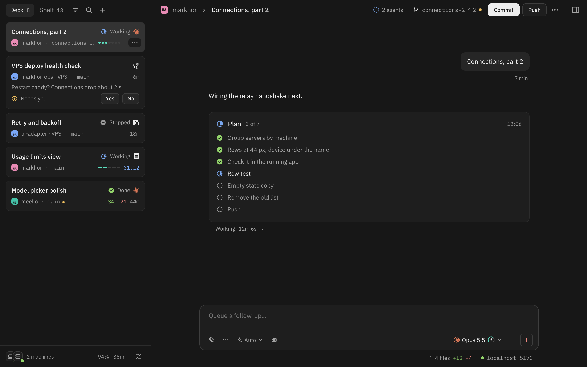

<p align="center">
  
</p>

<h1 align="center">Markhor</h1>

<p align="center">Run Claude Code, Codex, OpenCode and more on your Mac or a server, then drive them from any browser, your phone included.</p>

<p align="center">
  
</p>

<p align="center"><sub>This repo holds the release builds. The source is private. More at <a href="https://markhor.cc">markhor.cc</a>.</sub></p>

## What it does

- **Every agent in one place.** Claude Code, Codex, OpenCode, pi, Cursor and agents that speak ACP run side by side,
  each with its own login, billing and permissions.
- **Your phone answers for you.** When a run needs a decision, tap **Allow** or **Deny** from your phone.
- **Nothing you send goes missing.** A message is never lost, sent twice or silently re-sent, even on a bad network.
- **Light on your machine.** The server uses 2.9 MiB of memory at rest and 9.9 MiB with five chats streaming.

## Install

You need the [Tailscale](https://tailscale.com) app signed in, and at least one agent CLI on your `PATH` and logged
in, such as Claude Code (`claude`), Codex (`codex`) or OpenCode (`opencode`).

1. Run this on your Mac (macOS 13 or later) or Linux machine (x86_64 or arm64). On Windows, run it inside
   [WSL](https://learn.microsoft.com/windows/wsl/install) with systemd on.

   ```bash
   curl -fsSL https://markhor.cc/install | sh -s -- --harness claude --harness codex
   ```

   Repeat `--harness` for each agent; the first is the default. On a Mac it also adds the menu bar app.
2. Open the link it prints, and follow **Welcome to Markhor** to add your first project.
3. To use your phone, open **Settings**, go to **Devices paired to this server**, press **Pair a new device**, then
   **Create link**, and scan the QR code.

The installer picks the build for your system, checks it against its SHA-256 checksum, and sets Markhor up as a
service that starts on its own. On Linux, run `sudo loginctl enable-linger $USER` once so it keeps running after you
log out.

## Update

When a new version is out, Markhor says **Markhor vX is out** with **What's new** and, on owner devices, an
**Update** button. On a Mac the menu bar app also shows **Update available**. Update waits until no chat is running,
then keeps your settings, chats and pairings. Running the install command again does the same.

<details>
<summary><b>Installer options</b></summary>

Pass options after `sh -s --`, as in the install command above.

| Option | What it does |
|---|---|
| `--harness NAME` | Adds an agent. Repeat it for each one. The first is the default. |
| `--bind ADDR:PORT` | Listens here instead of your Tailscale address on port 7420. |
| `--peer-origin ORIGIN` | Lets another Markhor (for example your laptop's) reach this one. |
| `--tailscale-https` | Serves Markhor over HTTPS on your tailnet. |
| `--dry-run` | macOS only. Shows what it would do. Nothing is written. |
| `--uninstall` | macOS only. Stops Markhor, removes the launchd agent and the menu bar app. Your data stays. |

</details>

<details>
<summary><b>What it installs, and how to remove it</b></summary>

| What | Where |
|---|---|
| The `markhor` program | `~/.local/bin/markhor` |
| The menu bar app (macOS) | `/Applications/Markhor.app`, or `~/Applications` if `/Applications` isn't writable |
| The web UI | `~/.local/share/markhor/web` |
| Settings | `~/.config/markhor/markhor.env` |
| Your chats and history | `~/.markhor` |
| Logs | macOS: `~/Library/Logs/markhor`. Linux: `journalctl --user -u markhor` |

It runs as a launchd agent on macOS (while you are logged in) and as a systemd user service on Linux.

To remove it on macOS:

```bash
curl -fsSL https://markhor.cc/install | sh -s -- --uninstall
```

On Linux:

```bash
systemctl --user disable --now markhor.service markhor-backup.timer
```

To remove everything, also delete the folders above. Delete `~/.markhor` only if you want your history gone.

</details>

<details>
<summary><b>Download a build by hand</b></summary>

Each release has three packages, each with a `.sha256` file next to it:

| System | Package |
|---|---|
| macOS, Apple silicon or Intel | `markhor-macos-universal.tar.gz`, with the menu bar app |
| Linux x86_64 | `markhor-linux-x86_64.tar.gz` (static, any distro) |
| Linux arm64 | `markhor-linux-aarch64.tar.gz` (static, any distro) |

Download one from the [latest release](https://github.com/zainzafar90/markhor-releases/releases/latest), check it
with `shasum -a 256 -c <package>.sha256`, unpack it, and run `bash markhor/install.sh` with the options above.

</details>
